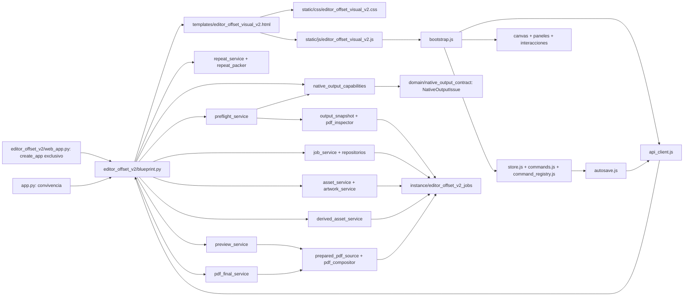

# Mapa de conexiones del Editor Offset Visual V2

Levantamiento estático inicial y contraste mediante ejecución, 2026-09-27; segunda revisión estática del código el 2026-10-03; validación dinámica posterior registrada al final. Actualización funcional Frente/Dorso de un pliego, MVP 1 + MVP 2, y Repeat Dorso por cara, MVP 3, el 2026-10-04. Los resultados fechados de cortes anteriores permanecen históricos. Este mapa distingue conexiones verificadas por lectura, observaciones ejecutadas y evidencia histórica. La segunda revisión estática no inició servicios ni ejecutó pruebas; la validación posterior es otro corte y no certifica el producto completo. La bitácora está en [41](41_TRABAJO_DIARIO_Y_BITACORA_V2.md), la aceptación previa de salida en [43](43_PLAN_SALIDA_PDF_HABITUAL_V2.md), y [46](46_AUDITORIA_COBERTURA_Y_HALLAZGOS_V2.md) concentra cobertura, riesgos, huecos, prioridades y deuda de tests sin duplicarlos aquí.

## Vista de conjunto



Desde 2026-09-28, `editor_offset_v2/web_app.py:create_app` es el host exclusivo del target v2 y del arranque habitual. Registra solo el blueprint V2, raíz con redirección al editor, identidad `/health/editor-offset-v2` y recursos estáticos V2 permitidos. Conserva las carpetas existentes y el límite HTTP efectivo de 32 MiB; no migra ni normaliza jobs al arrancar. Acepta configuración explícita y raíz de jobs del entorno de proceso; no carga `.env` general.

`app.py` sigue registrando V2 en convivencia con `routes.py` legacy, para target v1/both. Ese proceso continúa dependiendo de otros productos. Tras la entrega 1 del desacople, ningún `__init__` V2 carga contratos, servicios ni adaptadores del puente histórico. `NativeOutputIssue` pertenece al contrato nativo propio. La aceptación exclusiva bloquea imports de todo producto del repositorio ajeno a V2 y de los cinco módulos del puente, incluidas dependencias transitivas, y comprueba el flujo hasta archivos PNG/PDF y el diagnóstico HTTP nativo; no equivale todavía a un paquete distribuible sin archivos legacy.

## Entradas HTTP y consumidores

Todas las rutas viven en `editor_offset_v2/blueprint.py`, bajo `EDITOR_OFFSET_V2_ENABLED`. El HTML inserta un contexto JSON con URLs, layout, revisión y capacidades; la entrada JS lo entrega a `bootstrap.js`.

| Método y ruta | Servicio o resultado | Consumidor principal |
|---|---|---|
| GET `/editor_offset_visual_v2` | shell sin job | navegación de preparación |
| GET `/editor_offset_visual_v2/<job_id>` | shell con layout/contexto | `bootstrap.js` |
| POST `/api/editor-offset-v2/jobs` | `JobService`, revisión inicial | `api_client.js` / preparación |
| GET `/api/editor-offset-v2/jobs/<job_id>` | `JobService` | API disponible; el arranque del editor usa el contexto HTML |
| PUT `/api/editor-offset-v2/jobs/<job_id>/layout` | `JobService`, compare-and-swap con `base_revision` | `autosave.js` |
| POST `/api/editor-offset-v2/jobs/<job_id>/assets` | `AssetService` | `assets_panel.js` |
| GET `/api/editor-offset-v2/jobs/<job_id>/assets/<asset_id>/thumbnails/<page>` | sin `box`: PNG simple persistido al subir; con `?box=media|crop|trim|bleed`: prepara la caja física y rasteriza en memoria | panel de assets (sin `box`); canvas simple (con `box`) |
| GET `/api/editor-offset-v2/jobs/<job_id>/assets/<asset_id>/artwork/<page>` | `render_artwork` recibe `spec` en query, prepara contenido y usa el compositor nativo sobre un pliego temporal para devolver PNG | canvas de slots que requieren contenido preparado |
| POST `/api/editor-offset-v2/jobs/<job_id>/imposition/repeat` | `RepeatService`, propuesta temporal | `repeat_panel.js` |
| GET `/api/editor-offset-v2/jobs/<job_id>/output-capabilities` | `native_output_issues`, solo capacidades del renderer; identidad/versión/alcance nativos y bloqueo por operación; requiere preflight físico | API auxiliar sin URL en el contexto HTML ni llamada desde la UI habitual |
| POST `/api/editor-offset-v2/jobs/<job_id>/preflight` | `PreflightService`; recibe `face`, `dpi`, `allow_mirror_bleed` y devuelve decisiones por operación | `output_panel.js` |
| POST `/api/editor-offset-v2/jobs/<job_id>/preview` | `PreviewService`; gate Preview | `output_panel.js` |
| POST `/api/editor-offset-v2/jobs/<job_id>/pdf-final` | `PdfFinalService`; gate PDF | `output_panel.js` |
| POST `/api/editor-offset-v2/jobs/<job_id>/assets/<asset_id>/derived-page` | `DerivedAssetService`; gate derivados | inspector de contenido |

Los gates Preview, PDF y derivados son separados en `config.py` y `blueprint.py`; dev tools tiene otro flag. `scripts/start_editor_offset_v2.ps1` configura el arranque local habitual con Preview/PDF activos, derivados y dev tools apagados. Los scripts de QA usan configuración propia: no inferir la de otro despliegue a partir de ellos.

## Backend: inventario completo de propiedad V2

Son 42 archivos Python y 2 schemas JSON en `editor_offset_v2/`. La flecha de cada fila nombra la conexión funcional principal, no pretende listar cada import estándar o externo.

| Archivo | Papel y conexiones |
|---|---|
| `__init__.py` | exporta solo `LAYOUT_SCHEMA_VERSION`; no carga adaptadores históricos |
| `web_app.py` | fábrica exclusiva, rutas raíz/identidad/static V2 y límite HTTP → blueprint; no importa otros productos |
| `config.py` | flags, raíz de jobs y límite de subida → `app.py`/blueprint |
| `blueprint.py` | 14 endpoints y contexto HTML → servicios de aplicación |
| `domain/__init__.py` | geometría, versión Layout y validación; sin reexportar DTO históricos |
| `domain/layout_v2.py` | constantes y vocabulario de Layout V2 → validación, servicios |
| `domain/validation.py` | valida el layout → servicios de jobs/preflight/salida; `JobRepository` no invoca el validador |
| `domain/geometry.py` | geometría en mm, rotaciones y colisiones → Repeat, preflight, salida |
| `domain/work_bleed.py` | decisión por trabajo y cobertura física → preparación, preflight y fuentes de salida |
| `domain/crop_marks.py` | posición/reglas de marcas → compositor y pruebas |
| `domain/repeat_contract.py` | contrato de propuesta Repeat → servicio/adaptador |
| `domain/repeat_packer.py` | empaquetado Repeat propio → `repeat_engine_adapter.py` |
| `domain/output_contract.py` | DTO de la frontera de diagnóstico histórico → `output_service.py` |
| `domain/native_output_contract.py` | `NativeOutputIssue` inmutable y versión del diagnóstico HTTP nativo → capacidades propias; sin imports del puente |
| `domain/output_parity_contract.py` | tolerancias/criterios de paridad → pruebas de salida |
| `domain/preflight_contract.py` | versión, operaciones y estructura del reporte → preflight/consumidores |
| `domain/preview_policy.py` | presupuesto de píxeles Preview → capacidades/preflight/Preview |
| `application/__init__.py` | exporta lifecycle de jobs; no importa `output_service` histórico |
| `application/job_service.py` | crea/carga/guarda con revisión optimista → `job_repository.py` |
| `application/asset_service.py` | sube fuente y genera miniaturas → repositorio, inspector y renderer |
| `application/artwork_service.py` | imagen de arte para canvas → PDF preparado/compositor |
| `application/repeat_service.py` | valida petición y genera propuesta → adaptador Repeat |
| `application/native_output_capabilities.py` | `native_output_issues` produce `NativeOutputIssue` + bloqueos por operación → preflight/Salida y GET diagnóstico auxiliar |
| `application/preflight_service.py` | verifica layout, geometría, fuentes, cajas y decisiones → reporte/snapshot |
| `application/preview_service.py` | composición PDF y raster PNG de vista previa → fuente preparada/compositor |
| `application/pdf_final_service.py` | PDF de salida → fuente preparada/compositor |
| `application/derived_asset_service.py` | PDF derivado y manifiesto sin alterar fuente → repositorios |
| `application/output_service.py` | diagnóstico del puente antiguo → `editor_output_adapter.py`; fuera de Preview/PDF habitual |
| `infrastructure/__init__.py` | repositorio de jobs y validación de ID; no importa ni reexporta el adaptador histórico |
| `infrastructure/job_repository.py` | layout y carpetas; escritura atómica, revisión CAS → disco |
| `infrastructure/asset_repository.py` | staging y fuentes inmutables → disco |
| `infrastructure/process_lock.py` | bloqueo entre procesos → repositorios/salida |
| `infrastructure/output_snapshot.py` | congela entradas, revisión, cupo y publicación de salida → preflight/Preview/PDF |
| `infrastructure/pdf_inspector.py` | páginas y cajas PDF físicas declaradas → assets/preflight/fuente preparada |
| `infrastructure/thumbnail_renderer.py` | miniaturas PDF → assets |
| `infrastructure/prepared_pdf_source.py` | fuente física, sangrado y espejo autorizado → Preview/PDF/derivados |
| `infrastructure/pdf_compositor.py` | coloca/clipea páginas, marcas y caras → Preview/PDF/artwork |
| `infrastructure/repeat_engine_adapter.py` | adapta Repeat al empaquetador V2 → `domain/repeat_packer.py` |
| `infrastructure/artifact_lifecycle.py` | retención/recuperación; sin invocador productivo localizado, sí pruebas |
| `infrastructure/editor_output_adapter.py` | adaptador de diagnóstico histórico → `output_service.py` |
| `infrastructure/prepared_output_adapter.py` | ensayo offline del puente → import local de `montaje_offset_inteligente` |
| `infrastructure/legacy_output_probe.py` | sonda offline legacy → imports locales de `montaje_offset_inteligente`/`montaje_offset` |
| `schemas/layout-v2.schema.json` | contrato JSON de layout, leído en pruebas; la validación runtime está en `domain/validation.py` |
| `schemas/preflight-report.schema.json` | contrato JSON del reporte de preflight |

No se encontró un import a `engines/`, `services/` legacy ni `strategies/` en el camino habitual de Repeat o salida nativa. Los imports legacy identificados pertenecen a las sondas/ensayos indicados. `artifact_lifecycle.py` tiene cobertura propia, pero su presencia no equivale a ejecución en producción.

## Frontera de diagnóstico después de la entrega 1

```text
blueprint.output_capabilities -> native_output_issues -> NativeOutputIssue
output_panel.js -> POST preflight -> PreflightService -> native_output_issues
Preview/PDF -> snapshot + preflight fresco -> preparación/compositor propios

Solo imports directos de ensayos:
editor_output_adapter -> output_service + domain/output_contract
legacy_output_probe / prepared_output_adapter -> editor_output_adapter + motores legacy
```

GET `output-capabilities` mantiene `ok`, `job_id`, `revision`, `compatible`, `errors`, `warnings` e `issues`. Su semántica pasa explícitamente a capacidades nativas: `diagnostic_source=native-v2`, `diagnostic_scope=renderer_capabilities`, `diagnostic_contract_version=1`, `requires_preflight=true`; cada issue añade `blocks_operations`. `compatible` solo resume ausencia de errores de capacidades. No inspecciona fuentes físicas, geometría completa ni autoriza publicación. Por ejemplo, escala 0,75 ya soportada no devuelve el error histórico `UNSUPPORTED_CONTENT_SCALE`; clipping `none` conserva bloqueo nativo con referencias al slot/asset. El contexto HTML ya no incluye `output_capabilities_api_url`; la UI conserva su POST preflight y sus URLs de Preview/PDF.

Se retiraron reexportaciones históricas de los cuatro `__init__.py`, sin wrappers ni imports perezosos alternativos. La búsqueda de consumidores del repositorio encontró los ensayos usando módulos concretos; esos imports directos siguen disponibles y sus pruebas pasan. Si un consumidor externo utilizaba las antiguas reexportaciones, deberá importar el módulo histórico explícito. Ningún campo persistente, schema Layout ni reporte preflight cambió. Separar físicamente esos cinco módulos históricos y distribuir V2 con dependencias propias siguen pendientes.

`test_native_diagnosis_v2.py` caracteriza ocho políticas con códigos, severidades, bloqueos por operación y ausencia de mutación; verifica DTO inmutable, serialización y GET read-only que no reemplaza preflight físico. `test_exclusive_host_v2.py` bloquea los cinco módulos históricos durante el recorrido nativo completo. Aceptación de 2026-09-28: Python 647 passed, 1 skipped, 1 deselected (500); Node 165; Playwright 37. Detalle y protección de datos en 41 y actualización funcional en el apartado 11 de 45.

## Frontend: inventario completo

`templates/editor_offset_visual_v2.html` define shell y paneles, inserta el contexto JSON y carga los 35 archivos `static/js/editor_offset_v2/*.js` en orden `defer`, seguidos de `static/js/editor_offset_visual_v2.js`. `static/css/editor_offset_visual_v2.css` define layout, estados, canvas y responsive. Los módulos se conectan mediante el espacio `EditorOffsetV2` en navegador; la entrada inicia `Bootstrap.start()`. `dom_refs.js` centraliza los IDs estáticos del HTML.

| Grupo | Archivos JS y relación principal |
|---|---|
| Inicio/estado | `bootstrap.js` compone el editor; `dom_refs.js` localiza DOM; `store.js` conserva layout/revisión, selección, historial y estado temporal; `commands.js` muta reversiblemente; `command_registry.js` despacha acciones; `shortcut_manager.js` conecta teclado; `autosave.js` guarda; `api_client.js` llama las rutas V2 |
| Semántica/geometría | `geometry_kernel.js` y `geometry_view.js` calculan/convierten coordenadas; `edit_policy.js` aplica permisos/locks; `source_semantics.js` interpreta fuente; `work_bleed.js` aplica decisión de sangrado; `layout_metrics.js` deriva medidas |
| Canvas | `canvas_renderer.js` pinta pliego, slots y arte; `interactions.js` controla puntero, selección, zoom y pan; `snap_engine.js` ajusta movimientos |
| Preparación/contenido | `preparation.js` mantiene borradores de preparación; `assets_panel.js` presenta PDF/páginas/trabajos y registra acciones; `content_transform_inspector.js` edita corrección interna y derivados |
| Repeat/salida | `repeat_panel.js` pide propuesta y aplica un comando reversible; `output_panel.js` unifica Validar/Salida, preflight, Preview y PDF |
| Objetos/selección | `object_operations.js`, `objects_panel.js`, `advanced_selection.js`, `object_tree.js`, `position_inspector.js`, `nudge_controller.js` conectan operaciones, árbol, posiciones y desplazamiento |
| Alineación/precisión | `alignment_operations.js`, `arrangement_panel.js`, `precision_tools.js`, `precision_panel.js` calculan y presentan alineación, distribución, matriz, reglas, guías y medición |
| Pliego/navegación | `sheet_panel.js` configura pliego; `workflow_navigation.js` controla etapas; `responsive_panels.js` adapta paneles |

Los 35 archivos se cargan desde la plantilla y se enlazan desde el bootstrap o sus pares. No se halló import frontend V1. `api_client.js` conserva `getJob`, aunque el arranque con job recibe el layout en el contexto HTML; la ruta GET sigue disponible. Los controles de derivados y dev tools dependen de sus flags.

### Recorridos de datos

1. **Preparación:** PDF subido → `AssetService`/`pdf_inspector` → asset inmutable + miniaturas → borrador en `preparation.js` → comandos para works/slots → `EditorStore` → `SaveCoordinator` → PUT con `base_revision` → `JobRepository`.
2. **Repeat:** `store.activeFace` determina Frente/Dorso; el panel muestra `Repeat — Frente` o `Repeat — Dorso` y envía `face` explícito en el POST. Para Dorso, `source_overrides` opcionales por work (`asset_id`, `page`, `pdf_box`) eligen una fuente temporal; sin override se reutiliza `work.back_source` si existe. El servicio valida la fuente y el adaptador la copia a `slot.source`, sin cambiar work ni Layout al proponer. Los overrides no vacíos entran en el hash/ID de operación. Guardado pendiente → POST Repeat → `RepeatService`/packer V2 → propuesta temporal en Store ligada a cara, fuentes, revisión y versión local → `ApplyRepeatCommand` reversible → guardado. Cambio de cara o fuente invalida la propuesta; una respuesta tardía de la cara anterior se descarta. `add` conserva slots existentes y añade en la cara objetivo; `replace_work_face` retira solo slots de los works elegidos en esa cara. Los obstáculos del packing son solo los de la cara objetivo; se calculan coordenadas de edición y el flip se aplica después en `pdf_compositor.py`. No se publica un layout al solo proponer.
3. **Salida:** Validar/Salida → guardado → POST preflight con opciones → reporte con decisiones para Preview/PDF/CTP. La UI examina la decisión de la operación elegida y solicita el artefacto con `expected_revision`. Cada generación backend congela un snapshot nuevo, ejecuta y consume su propio preflight; no reutiliza el reporte previo de la UI como autorización. El preflight interno prepara fuentes reutilizadas por la composición: Preview rasteriza el PDF compuesto a PNG y PDF final publica el PDF compuesto (o lo rasteriza si `export.render_mode` lo pide). El canvas usa miniatura por caja o artwork preparado según el slot; compartir preparación/compositor no demuestra paridad de los archivos.
4. **Historial:** comandos → undo/redo del store → dirty state → autosave; la revisión del servidor se comprueba en el PUT. Selección, viewport, borradores, propuesta Repeat y opciones de salida son temporales.
5. **Derivados:** inspector de contenido → `api_client.materializeDerivedPage` → POST `derived-page` → PDF y manifiesto bajo `derived/` → `SetSlotDerivedSourceCommand` en el store → autosave/PUT con `base_revision`. La publicación física precede al CAS del layout; el POST por sí solo no persiste la referencia.
6. **Frente/Dorso de un pliego (MVP 1 + MVP 2):** el botón `Habilitar dorso` despacha `ConfigureBackFaceCommand` mediante `command_registry.js`; modifica `faces.enabled`, `faces.duplex` y `export.faces`, entra en historial y autosave/CAS. Los tabs de `bootstrap.js` llaman `store.setActiveFace` sin mutar layout ni crear historial; cancelan gestos/borradores y limpian selección/slot clave. `assets_panel.js` crea el slot en la cara activa con el PDF/página escogidos en `slot.source`; `object_operations.js` limita paste a la cara visible. Canvas, árbol e inspectores usan la cara temporal. `output_panel.js` identifica cara/slot en preflight, permite Preview individual por cara y PDF `both` con orden y flip persistidos. `activeFace` no se guarda. Repeat Dorso opera sobre esa misma cara temporal; su fuente explícita por work viaja solo en la petición Repeat.

### Segunda revisión estática: recorridos visuales (2026-10-03)

- **Miniatura simple persistida:** `AssetService.upload_pdf` guarda el PDF fuente en staging, lo inspecciona y `thumbnail_renderer.render_thumbnails` genera `assets/<asset_id>/thumbnails/page_<n>.png` antes de incorporar el asset al layout mediante `JobService.save_layout`. Rasteriza la página de PyMuPDF con borde máximo de 900 px y escala máxima 2; `assets_panel.js` usa la URL sin `box`. La ruta sirve ese archivo con respuesta condicional.
- **Miniatura por caja, sin archivo nuevo:** `canvas_renderer.artworkForSlot` usa `?box=<pdf_box>` cuando el slot no requiere preparación de contenido. `blueprint.asset_thumbnail` llama `AssetService.box_thumbnail`: verifica asset, hash del PDF, cantidad de páginas, caja y rotación contra metadatos; luego `prepare_source` y `render_prepared_thumbnail` generan PNG en memoria. La fuente de esta ruta tiene un límite propio de 50 MiB; no se reutiliza la miniatura simple guardada. La respuesta tiene ETag SHA-256 y caché HTTP de 3600 s.
- **Artwork preparado:** si hay derivado, sangrado o transformación interna distinta de los valores simples, el canvas pide `/artwork/<page>?spec=...`. La ruta limita `spec` a 4096 caracteres; `render_artwork` crea un `OutputSnapshot`, usa `PreviewService._prepared_slot`, compone un pliego temporal con `pdf_compositor.compose_pdf` y rasteriza a PNG. La rotación del slot sigue en el grupo SVG y la función transforma el offset para sus ejes. Si falta sangrado físico sin espejo autorizado, muestra trim con margen descubierto e informa `X-V2-Coverage: missing_bleed`; no publica Preview/PDF ni modifica layout. Su respuesta declara caché privada de 60 s.
- **Relación con salida:** preflight, Preview y PDF final reutilizan `_prepared_slot` y el compositor, pero la miniatura por caja no atraviesa ese pliego y artwork usa una geometría temporal y raster distinto. Preview compone PDF y lo rasteriza al tamaño del pliego y DPI solicitados; PDF final conserva el compuesto vectorial salvo `export.render_mode=raster`, que rasteriza cada página al DPI pedido e inserta esa imagen en un nuevo PDF bajo el límite de 24 millones de píxeles por página. Los PNG del canvas son aproximaciones de visualización; la paridad productiva requiere comparar artefactos. `OutputSnapshot.prepared` (por slot), `prepared_by_source` (por fuente/opciones) y el caché de documentos PDF del compositor viven solo durante una petición; no son cachés persistentes entre solicitudes. Preview/PDF responden con bytes retenidos y `Cache-Control: no-store`.

### Segunda revisión estática: preflight y publicación (2026-10-03)

`POST /preflight` llama `PreflightService.run`, que crea un `OutputSnapshot` de layout y opciones, inspecciona los archivos físicos, comprueba hashes/cajas/geometría/capacidades, prepara las fuentes de slots y publica `reports/pfr_<id>.json`. Devuelve decisiones separadas para Preview, PDF final y CTP; CTP permanece deshabilitado. Este POST es independiente y no adquiere el semáforo de generaciones de Preview/PDF; las rutas de miniatura por caja y artwork tampoco pasan por ese semáforo. Aunque no cambia el layout, sí escribe un reporte. El schema `preflight-report.schema.json` y el validador Python del contrato describen el reporte; la ejecución usa el validador Python.

`PreviewService.render` y `PdfFinalService.render` pasan por `snapshot_operation`: validan opciones y `expected_revision`, admiten como máximo dos generaciones simultáneas por proceso, y crean un snapshot nuevo. Cada una ejecuta y consume su propio reporte fresco; el reporte previo de la UI no se usa como autorización backend. `PreflightService.consume` comprueba política, sujeto, revisión, opciones, archivos efectivos y decisión de la operación. La preparación hecha en preflight queda en el snapshot y el compositor la reutiliza. El reporte se publica con control de revisión del layout (`publication(..., sources=False)`); la publicación posterior de PNG/PDF comprueba también los bytes de fuentes cargadas (`sources=True`). Los artefactos de Preview/PDF final se escriben en temporal, se sincronizan y se reemplazan individualmente de forma atómica bajo `.job.lock` y `.publish.lock`; un rechazo previo no publica esa salida parcial. Esta garantía por archivo no convierte en transacción conjunta al PDF y manifiesto derivados descritos más abajo. La disponibilidad del semáforo es por proceso Python, no un cupo distribuido entre hosts.

| Límite comprobado en código | Frontera |
|---|---|
| 32 MiB HTTP en ambos hosts; 50 MiB configurables en `AssetService` | En esos hosts, el límite HTTP predeterminado corta antes del límite de almacenamiento del upload; una configuración explícita puede cambiar el valor HTTP. |
| 250 páginas por PDF (`pdf_inspector`) | Inspección usada por upload y validación física. |
| 128 MiB de bytes fuente leídos por `OutputSnapshot` | Presupuesto por petición para fuentes; no es un límite de memoria total de PyMuPDF/Pillow ni del proceso. |
| 24 millones de píxeles | Pliego Preview según `preview_policy`; también hay presupuestos para imágenes intermedias, espejo, materialización y PDF raster explícito en sus módulos. El límite del pliego Preview no bloquea por sí solo un PDF vectorial. |
| 500 slots por petición de salida nativa | Límite de `native_output_capabilities`; las mediciones históricas y posteriores del caso sintético se distinguen en los apartados de ejecución. |
| 128 tipos, 2000 colocaciones/obstáculos, 1024 rectángulos libres y presupuesto de esfuerzo | Límites internos del `repeat_packer` propio; son distintos del límite de salida de 500 slots. |

## Persistencia, configuración y límites físicos

La raíz predeterminada es `instance/editor_offset_v2_jobs/<job_id>/` con `layout_v2.json`, `assets/`, `derived/`, `previews/`, `outputs/` y `reports/`; `config.py` permite cambiarla. Cada PDF subido reside en `assets/<asset_id>/` con fuente, metadatos y miniaturas; `derived/assets/<asset_id>/page_<n>/` aloja PDF y manifiesto. Los reportes, PNG Preview y PDF final se guardan en sus carpetas respectivas. `JobRepository.create_job` crea estas carpetas y escribe el layout con temporal, `fsync` y `os.replace`; `replace_layout_if_revision` usa lock de hilo y lock de archivo, compara la revisión y hace el mismo reemplazo atómico. `AssetService.upload_pdf` hace staging, inspección y miniaturas, finaliza la carpeta del asset y después incorpora su referencia al layout por `JobService.save_layout` con `base_revision`; ante error controlado intenta limpiar staging o finalizado. Las fuentes originales no se reescriben en la edición de layout.

El layout usa `layout_schema_version=2`, milímetros, slots con centro trim, rotaciones cardinales, fuentes referenciadas y `job.revision`. El schema JSON y `validation.py` deben revisarse juntos al cambiar contrato; la validación runtime de guardado es Python, mientras el repositorio comprueba JSON legible y CAS. El PDF inspector toma las cajas realmente declaradas; una MediaBox sola no crea TrimBox/BleedBox implícitas. `works[].bleed_strategy` admite `source_only`, `mirror_if_missing` o ausencia histórica, con semántica distinta. La cobertura por cajas no certifica tinta útil en el borde.

### Derivados, referencias y lifecycle

El endpoint `derived-page` requiere su flag, valida asset/página/caja, vuelve a leer y verificar el hash del PDF original, prepara la fuente y, si corresponde, hornea la transformación con PyMuPDF/Pillow. `DerivedAssetService.materialize_page` escribe primero un PDF `r<revision>_<hash>.pdf` y luego un JSON homónimo con hashes, caja, sangrado, transformación, revisión leída y `derived_key`. Cada archivo tiene reemplazo atómico y `.publish.lock` propio; PDF y manifiesto no forman una transacción única. La petición no lleva `base_revision` ni guarda el layout. El inspector JS recibe la respuesta, ejecuta `SetSlotDerivedSourceCommand` (reversible) y el guardado posterior añade `source.derived` al layout. Preflight/Preview/PDF vuelven a leer el derivado, comprueban ruta y hash del archivo contra la referencia y fuente original; el manifiesto aporta procedencia de sangrado, pero su `layout_revision` no actúa como CAS de la referencia.

**Observación dinámica posterior a la revisión estática:** en un job temporal, `derived-page` respondió 201 y publicó PDF y manifiesto; un PUT posterior con `base_revision` viejo devolvió 409 `REVISION_CONFLICT`. El layout persistido no incorporó `source.derived`, mientras ambos archivos derivados permanecieron. Esto confirma que puede existir un par derivado sin referencia tras ese conflicto; fue un sondeo controlado, no un test permanente ni una observación de todos los conflictos. La política de eliminación, retención o reconciliación sigue sin definirse. **Riesgo aún inferido del código:** un fallo entre las dos escrituras atómicas puede dejar solo el PDF; esa secuencia no se ejecutó en el sondeo. Una referencia persistida que apunte a archivo ausente o cambiado se bloquea en lectura física, pero no hay reconciliación automática demostrada. `artifact_lifecycle.py` recupera temporales y retiene artefactos de `reports/`, `previews/` y `outputs/` cuando se llama explícitamente; no recorre `derived/`. La búsqueda de invocadores Python productivos encontró únicamente su definición, por lo que no se debe describir retención automática. `.job.lock` y `.publish.lock` son archivos de bloqueo, no layouts ni salidas.

## Referencias fuera del producto V2

### Dependencias técnicas

`requirements.txt` declara dependencias del proceso completo, no un entorno V2 aislado. Flask/Werkzeug gestionan rutas, plantilla, upload y respuestas; `RequestEntityTooLarge` se convierte en JSON 413 en el host exclusivo. PyMuPDF (`fitz`) inspecciona cajas/rotación, prepara páginas, importa formularios PDF en `pdf_compositor` y rasteriza miniaturas, artwork, Preview y PDF raster explícito. Pillow se usa en Preview, sangrado espejo y materialización raster de transformaciones; por ello límites de píxeles y consumo de memoria afectan la salida. ReportLab genera fixtures y participa en el ensayo `prepared_output_adapter.py`; PyPDF2 aparece en `legacy_output_probe.py`, no en el compositor nativo habitual. No se localizó import productivo V2 a `engines/`, `services/` ni `strategies/` en los recorridos HTTP habituales. Estas bibliotecas generales son distintas del código de producto V1 compartido.

### Hosts, scripts y pruebas: fronteras distintas

- **Exclusivo:** `web_app.create_app` no importa `app.py` ni `routes.py`; registra solo el blueprint V2, redirige `/`, expone identidad en `/health/editor-offset-v2` y sirve CSS/JS V2 con lista acotada. Fija V2 habilitado, `MAX_CONTENT_LENGTH=32 MiB` salvo configuración explícita, y acepta `EDITOR_OFFSET_V2_JOBS_ROOT` del proceso. No carga el `.env` general. El `before_request` del blueprint comprueba el flag V2; no hay autenticación de usuario implementada en ese blueprint. Los scripts locales ejecutan Flask en su dirección de loopback predeterminada. El test `test_exclusive_host_v2.py` bloquea imports de producto ajeno y de los cinco módulos históricos en su recorrido nativo; esto no prueba distribución standalone.
- **Convivencia:** `app.py` llama `load_dotenv()`, importa `routes.py`, `pdf_medidor_pro.api` y `sistema_presupuesto.api`, y registra V2 con los demás blueprints. `routes.py` importa en carga los motores `engines.nesting_pro_engine` (que importa `rectpack`) y `step_repeat_pro_engine`, servicios `editor_offset_*`, `montaje_offset_inteligente`, `OpenAI`, ReportLab y otros productos. La cadena `routes.py` → `services.editor_offset_http_service` → `services.editor_offset_output_service` carga además `PyPDF2`; `editor_offset_http_service` importa `cuadernillos.simulator`. Son dependencias del proceso v1/both, no llamadas demostradas desde una ruta V2. La ausencia de dependencia de producto compartido confirmada para el host exclusivo no debe extrapolarse a convivencia.
- **Arranque local:** `scripts/start_editor_offset_v2.ps1` pide Preview/PDF=1 y derivados=0; `start_editor_offset_v2_output_qa.ps1` pide los tres=1. Ambos delegan en `.agents/skills/editor-offset-local-qa/scripts/start_flask.ps1 -Target v2`, que ejecuta `web_app.create_app` sin reloader y deja dev tools=0 salvo switch explícito. La skill detecta/reutiliza un proceso que ya sirve el target; si lo reutiliza, conserva los flags originales. Los scripts de verificación HTTP comprueban el perfil esperado y señalan cuándo hace falta `-Restart`; fijar variables en el script por sí solo no cambia un proceso ya iniciado. `-Target v1/both` usa `app.py`.
- **QA separada:** `tests/editor_offset_v2/` contiene contratos/servicios/repositorios/compositor, ensayos legacy y aceptación de recursos; `conftest.py` genera PDF sintético con PyMuPDF. Los 19 tests Node usan módulos CommonJS y fixtures JSON compartidos para comandos, geometría, preparación, Repeat y UI lógica. Los seis Playwright V2 comparten helpers entre archivos: `v2_server` y la caracterización UX crean host exclusivo con Preview/PDF apagados y raíz temporal; `output_server` crea otro con Preview/PDF/derivados activos y raíz temporal. Cubren recorridos de navegador y, en algunos casos, archivos generados; no describen los flags de un Flask habitual ya existente. Las pruebas de sondas legacy no certifican ese puente como salida V2. Los conteos y observaciones de 2026-09-27/28 al final son históricos; en la revisión estática de 2026-10-03 no se ejecutaron tests, Flask ni navegador.

| Zona | Archivos relacionados y uso |
|---|---|
| Arranque | `editor_offset_v2/web_app.py:create_app` exclusivo; `app.py` convivencia; `scripts/start_editor_offset_v2.ps1`, `scripts/check_editor_offset_v2_start.py`; `scripts/start_editor_offset_v2_output_qa.ps1`, `scripts/check_editor_offset_v2_output_qa.py` |
| Operación local | `.agents/skills/editor-offset-local-qa/SKILL.md` y `scripts/check_flask.py`, `start_flask.ps1`, `stop_flask.ps1` dentro de esa skill |
| Repositorio | `.gitignore` ignora la raíz de jobs; `AGENTS.md` fija reglas; archivo raíz `tatus` contiene solo avisos Git históricos con nombres V2 y no participa del editor |
| Fixture PDF | `tests/fixtures/editor_offset_v2/` contiene `boxes-missing.pdf`, `boxes-offset.pdf`, `front-back-flip.pdf`, `marks-clipping.pdf`, `mirror-bleed-candidate.pdf`, `multipage-rotations.pdf` y `generate_pdf_fixtures.py` |
| Fixture JSON | en la misma carpeta: `layout_v2_minimal.json`, `layout_v2_complete.json`, `geometry_cases.json`, `repeat_cases.json`, `output_adapter_cases.json`, `crop_mark_dimensions.json`, `work_bleed_coverage.json`, `pdf_fixture_manifest.json` |

### Pruebas localizadas

- **Python (`tests/editor_offset_v2/`, 31 módulos + `conftest.py`):** `test_exclusive_host_v2.py`, `test_local_host_check_v2.py`, `test_native_diagnosis_v2.py`, `test_artifact_lifecycle_v2.py`, `test_asset_service_v2.py`, `test_assets_routes_v2.py`, `test_derived_parity_v2.py`, `test_frontend_placeholder_v2.py`, `test_geometry_v2.py`, `test_job_repository_v2.py`, `test_job_service_v2.py`, `test_layout_v2_contract.py`, `test_legacy_output_probe_v2.py`, `test_native_compositor_v2.py`, `test_output_acceptance_v2.py`, `test_output_adapter_v2.py`, `test_output_parity_contract_v2.py`, `test_output_safety_v2.py`, `test_pdf_final_v2.py`, `test_pdf_fixture_parity_v2.py`, `test_pdf_inspector_v2.py`, `test_preflight_decisions_v2.py`, `test_preflight_v2.py`, `test_prepared_output_probe_v2.py`, `test_prepared_pdf_source_v2.py`, `test_preview_v2.py`, `test_repeat_engine_adapter_v2.py`, `test_repeat_packer_v2.py`, `test_repeat_service_v2.py`, `test_routes_v2.py`, `test_work_bleed_v2.py`.
- **Node (`tests/editor_offset_v2/js/`, 19 módulos):** `advanced_selection_object_tree_v2.test.cjs`, `alignment_distribution_matrix_v2.test.cjs`, `assets_commands_v2.test.cjs`, `crop_marks_v2.test.cjs`, `editor_core_v2.test.cjs`, `front_back_mvp_v2.test.cjs`, `geometry_parity_v2.test.cjs`, `object_operations_v2.test.cjs`, `output_diagnosis_v2.test.cjs`, `positioning_commands_v2.test.cjs`, `preparation_v2.test.cjs`, `repeat_commands_v2.test.cjs`, `repeat_proposal_freshness_v2.test.cjs`, `responsive_panels_v2.test.cjs`, `rulers_guides_snap_measurement_v2.test.cjs`, `semantic_stabilization_v2.test.cjs`, `sheet_configuration_v2.test.cjs`, `work_bleed_v2.test.cjs`, `workflow_navigation_v2.test.cjs`.
- **Navegador (`tests/playwright/`, 6 V2):** `test_editor_offset_v2.py`, `test_editor_offset_v2_ux_characterization.py`, `test_editor_offset_v2_output_integration.py`, `test_editor_offset_v2_native_repeat.py`, `test_editor_offset_v2_preparation.py`, `test_editor_offset_v2_work_bleed.py`. Otros tests Playwright de `test_editor_*` corresponden a V1 y no se incluyen en el mapa V2.

### Documentación localizada

En el corte inicial había 49 Markdown anteriores a este mapa; el árbol revisado el 2026-10-03 contiene además este 44 y `45_INFORME_SEGUNDA_REVISION_SUBAGENTES_Y_FUNCIONAMIENTO_V2.md` (informe histórico de revisión). Los nombres siguientes localizan antecedentes, no prueban el estado actual del código.

- **Base, shell y herramientas (01–17):** `01_CONTRATO_LAYOUT_V2.md`, `02_KERNEL_GEOMETRICO_V2.md`, `03_ADAPTADOR_SALIDA_V2.md`, `04_SHELL_Y_JOBS_V2.md`, `05_CANVAS_STORE_V2.md`, `06_ASSETS_Y_SLOTS_V2.md`, `07_REPEAT_V2.md`, `08_AUDITORIA_ESTADO_ACTUAL_V2.md`, `09_PLAN_HERRAMIENTAS_MANUALES_V2.md`, `10_ESTABILIZACION_SEMANTICA_V2.md`, `11_DECISIONES_ARQUITECTONICAS_PENDIENTES_V2.md`, `12_CORRECCION_COMPATIBILIDAD_DE_MEDIDA_Y_ETIQUETAS_V2.md`, `13_POSICIONAMIENTO_Y_COMANDOS_V2.md`, `14_OPERACIONES_DE_OBJETO_Y_CLIPBOARD_V2.md`, `15_ALINEACION_DISTRIBUCION_Y_MATRIZ_V2.md`, `16_SELECCION_AVANZADA_Y_ARBOL_V2.md`, `17_REGLAS_GUIAS_SNAP_Y_MEDICION_V2.md`.
- **Estado, UX y salida inicial (18–31):** `18_ESTADO_ACTUAL_POST_EXPLORACIONES_1_A_4_V2.md`, `19_PLAN_Y_TRAZABILIDAD_REDISENO_UX_V2.md`, `20_ESTADO_ACTUAL_POST_REDISENO_UX_V2.md`, `21_CONTRATO_PREFLIGHT_V2.md`, `22_ENSAYO_REUTILIZACION_SALIDA_V1.md`, `23_PREPARACION_FUENTES_Y_PARIDAD_SALIDA_V2.md`, `24_PREFLIGHT_EJECUTABLE_V2.md`, `25_AUDITORIA_COMPLETA_QA_V2.md`, `26_FIXTURES_Y_PARIDAD_PDF_V2.md`, `27_PREVIEW_MINIMA_GATED_V2.md`, `28_PARIDAD_PREVIEW_CANVAS_V2.md`, `29_TRANSFORMACIONES_PREVIEW_V2.md`, `30_MARCAS_Y_DUPLEX_PREVIEW_V2.md`, `31_PDF_FINAL_GATED_V2.md`.
- **Multipágina, derivados y salida avanzada (32A–40):** `32A_TRABAJOS_MULTIPAGINA_V2.md`, `32B_CORRECCIONES_GRAFICAS_V2.md`, `32C_ASSETS_DERIVADOS_V2.md`, `32D_INTEGRACION_DERIVADOS_SALIDA_V2.md`, `32E_GUARDIA_PARIDAD_DERIVADOS_V2.md`, `32F_MATERIALIZACION_TRANSFORMADA_V2.md`, `33_PARIDAD_DERIVADOS_PREVIEW_PDF_V2.md`, `34_REPEAT_MULTIPAGINA_ORIENTACIONES_V2.md`, `35_PREFLIGHT_OBLIGATORIO_SALIDA_V2.md`, `36_ENDURECIMIENTO_OPERATIVO_V2.md`, `37_CONTRATO_PARIDAD_SALIDA_V2.md`, `38_CONCURRENCIA_RETENCION_RECUPERACION_V2.md`, `39_PLAN_SAFE_CIERRE_SALIDA_PRODUCTIVA_V2.md`, `40_AUDITORIA_INTEGRAL_MAPA_Y_PLAN_DE_MEJORAS_V2.md`.
- **Trabajo actual:** `41_TRABAJO_DIARIO_Y_BITACORA_V2.md` es la bitácora; `42_PLAN_PREPARACION_UNIFICADA_Y_REPEAT_PROPIO_V2.md` y `43_PLAN_SALIDA_PDF_HABITUAL_V2.md` registran entregas concretas. `assets/19_propuesta_visual_redisenio_incremental_v2.png` es una referencia visual histórica, no recurso cargado por el editor.

## Alcance del levantamiento inicial

El inventario inicial procede de búsqueda de archivos/referencias y lectura de puntos de composición, rutas, imports, servicios y pruebas por tres revisiones paralelas. No demuestra cobertura exhaustiva. En ese corte, el arranque dependía de `app.py`; la entrada exclusiva y su aceptación de 2026-09-28 se describen arriba y en 41. Los módulos de ensayo legacy no son la salida habitual; la retención en `artifact_lifecycle.py` no aparece conectada a una ruta productiva. Para verificar un cambio concreto, recorrer su acción de UI, endpoint, servicio, persistencia/artefacto y prueba pertinente.

## Contraste mediante ejecución — 2026-09-27 (histórico; no repetido en 2026-10-03)

Tres subagentes revisaron áreas distintas y el agente principal recorrió la copia `ev2_712410ef8ebb0395c13d304a` en Flask habitual. Las conexiones principales coincidieron con la ejecución. Se corrigieron cuatro precisiones del mapa: opciones del POST preflight, preflight fresco dentro de cada generación, validación propiedad de servicios y `render_artwork` como función.

| Evidencia | Resultado y límite |
|---|---|
| Python V2 antes de la corrección | `pytest tests/editor_offset_v2 -q -k 'not (bounded_placement_load and 500)'`: 623 passed, 1 skipped por privilegio de symlink Windows, 1 deselected; incluye cargas 14/100 |
| Rendimiento 500 aislado | `test_output_acceptance_v2.py::test_bounded_placement_load_with_shared_vector_source[500]`: fallo, 66,797 s frente a umbral 60; PDF de 500 textos correcto. Umbral sin cambios |
| Node V2 | los 18 módulos `.test.cjs`: 165 passed |
| Navegador V2 | los seis archivos Playwright: 37 passed; servidores/raíces temporales, incluyendo comparación SVG/Preview/PDF, conflictos y sangrado |
| Responsive adicional | smoke Playwright a 1440×1000, 540×844 y 390×844: tabs por click, diagnóstico, identidad, consola y ausencia de overflow del documento. Barras con scroll horizontal local |
| Corrección backend | 7 regresiones nuevas: estructura corrupta devuelve JSON `INVALID_LAYOUT` sin publicación y conserva fuentes/layout; errores semánticos siguen como diagnóstico. Después: 56 passed en preflight, decisiones, seguridad, Preview y PDF |
| Flask habitual | PID registrado/identificado 11432 → 16248, dev tools=0 y perfil normal. Primera comprobación posterior tuvo timeout en raíz; segundo intento obtuvo raíz/V2 200. Gates/contexto comprobados por script |
| Copia del montaje real | Repeat de reemplazo 6/6, propuesta temporal, aplicar/undo/redo/save/reload. Se comprobó bloqueo PDF por clipping TrimBox en piezas de trabajos históricos y se ajustó explícitamente a BleedBox en la copia. Revisión final 6, seis slots, PDF 1 página ~700×700 mm; Preview 4134×4134 a 150 dpi y raster PDF idénticos en RGB |
| Original protegido | montaje original revisión 42, layout y dos PDF fuente: hashes iniciales/finales iguales |

Se corrigió un defecto productivo descubierto en la auditoría: layouts guardados con campos requeridos ausentes o tipos estructurales incorrectos causaban excepción al recorrer geometría/fuentes. `preflight_service.py` los rechaza antes de ese recorrido; las tres rutas devuelven JSON500 `INVALID_LAYOUT`, preservan los datos y no publican artefactos. También se verificó en el Flask reiniciado con un job QA temporal que se restauró al estado válido inicial. La suite amplia Python precede a este cambio; las 56 pruebas relevantes y el probe live son posteriores. No sumar conteos de reejecuciones.

Comandos de regresión ejecutados desde la raíz del repositorio:

```powershell
venv/Scripts/python.exe -m pytest tests/editor_offset_v2 -q -k 'not (bounded_placement_load and 500)' --basetemp=.codex-runtime/audit44-backend-20260927 --junitxml=.codex-runtime/audit44-backend-20260927-results.xml
venv/Scripts/python.exe -m pytest 'tests/editor_offset_v2/test_output_acceptance_v2.py::test_bounded_placement_load_with_shared_vector_source[500]' -q --basetemp=.codex-runtime/audit44-backend-500-20260927 --junitxml=.codex-runtime/audit44-backend-500-20260927-results.xml -o junit_family=legacy
$editorV2JsTests = Get-ChildItem -LiteralPath tests/editor_offset_v2/js -Filter *.test.cjs | ForEach-Object { $_.FullName }
node --test $editorV2JsTests
venv/Scripts/python.exe -m pytest tests/playwright/test_editor_offset_v2.py tests/playwright/test_editor_offset_v2_ux_characterization.py tests/playwright/test_editor_offset_v2_output_integration.py tests/playwright/test_editor_offset_v2_preparation.py tests/playwright/test_editor_offset_v2_native_repeat.py tests/playwright/test_editor_offset_v2_work_bleed.py -q
venv/Scripts/python.exe -m pytest tests/editor_offset_v2/test_preflight_v2.py tests/editor_offset_v2/test_preflight_decisions_v2.py tests/editor_offset_v2/test_output_safety_v2.py tests/editor_offset_v2/test_pdf_final_v2.py tests/editor_offset_v2/test_preview_v2.py -q
git diff --check
```

Artefactos backend/XML en `.codex-runtime/audit44-backend-*`; copia, hashes, métricas y probe live en `.codex-runtime/audit44/`; capturas Playwright en el directorio temporal `pytest-273` y smoke `ev2-mobile-audit-mhb3igqi`. CUA validó controles por teclado, consola y resultados; su evento de descarga agotó el tiempo pese a que la UI indicó descarga y el PDF publicado pudo inspeccionarse. Los Playwright sí comprobaron la descarga. No hubo suite global/V1, certificación industrial ni commit/push.

### Límites funcionales para publicaciones

V2 representa un pliego y piezas/páginas con cantidades independientes. Desde MVP 1 + MVP 2, la UI permite habilitar Dorso explícitamente, navegar y editar piezas independientes en ambas caras, elegir PDF/página por slot, previsualizar cada cara y generar PDF de ambas. Repeat Frente y Dorso operan de forma independiente en el pliego actual. No hay Repeat sincronizado entre caras. No hay contrato de secuencia editorial, múltiples pliegos, firmas, encuadernación ni creep. Por tanto, preparar un PDF multipágina y repetir sus formas no equivale a imponer una revista para doblar y encuadernar. Esas son posibles ampliaciones que requieren decisiones y pruebas propias, no conexiones existentes del mapa.

## Validación dinámica posterior a la segunda revisión estática — corte 2026-10-03

Este corte es posterior al levantamiento inicial, al contraste del 2026-09-27 y a la revisión **solo estática** de 2026-10-03. No se suma a los conteos anteriores como una sola corrida ni reemplaza la arquitectura leída en el código.

| Recorrido ejecutado | Observación y límite |
|---|---|
| Host exclusivo y perfil | Mediante la skill local se verificaron la identidad `/health/editor-offset-v2`, las rutas V2 y el perfil efectivo del proceso observado: Preview/PDF activos y derivados/dev tools apagados en el arranque habitual. Los hosts temporales de pruebas de salida habilitan derivados por separado; reutilizar un proceso no cambia sus flags. No se ejecutó una validación equivalente del proceso de convivencia. |
| Suites V2 | Python **649 passed**, Node **165 passed** y Playwright V2 **37 passed** en sus respectivas ejecuciones. Verifican esos recorridos de QA; no son certificación general ni se ejecutaron al editar este mapa. La auditoría de cobertura y sus límites están en [46](46_AUDITORIA_COBERTURA_Y_HALLAZGOS_V2.md). |
| Carga de 500 slots | El caso sintético aislado de `test_bounded_placement_load_with_shared_vector_source[500]` tardó aproximadamente **21,86 s** y pasó el umbral de 60 s; el resultado histórico del 2026-09-27 fue **66,797 s** y falló. Sin equivalencia controlada de entorno/carga ni serie de mediciones, no se infiere rendimiento estable. |
| Concurrencia dentro de un proceso | `test_four_requests_are_bounded_and_capacity_recovers` retuvo dos generaciones PDF, obtuvo `OUTPUT_BUSY` para otras dos y luego comprobó recuperación del cupo. Esto ejecuta el semáforo de ese proceso; no prueba un límite distribuido ni preflight independiente simultáneo. |
| Materialización y CAS | El sondeo controlado de `derived-page` 201 seguido de PUT stale 409 dejó layout sin referencia y PDF/manifiesto presentes, tal como se detalla en «Derivados, referencias y lifecycle». No demuestra política automática de recuperación. |


## Actualización de ejecución — Frente/Dorso de un pliego, 2026-10-04

La entrega MVP 1 + MVP 2 se comprobó con Python V2 **653 passed** (84,75 s), Node V2 **170 passed** (0,61 s, 19 módulos) y los seis archivos Playwright V2 **38 passed** (150,52 s). Son corridas posteriores e independientes de los conteos históricos anteriores. `test_job_service_v2.py` y `test_pdf_final_v2.py` amplían persistencia/CAS, Preview por cara, preflight con issue solo en Dorso y contenido físico de PDF `both`; `front_back_mvp_v2.test.cjs` y los tests Node existentes cubren estado temporal, comando, creación, clipboard e historial; `test_editor_offset_v2_output_integration.py` recorre ambas caras en navegador. El PDF sintético asimétrico comprueba dos páginas, orden y reflexiones X/Y de los tres valores de flip. La evidencia no define registro de máquina, paridad visual universal ni política nueva para salida Frente aislada ante error exclusivo de Dorso. No se modificaron schema, JobService, PreviewService, PdfFinalService, preflight ni compositor.
